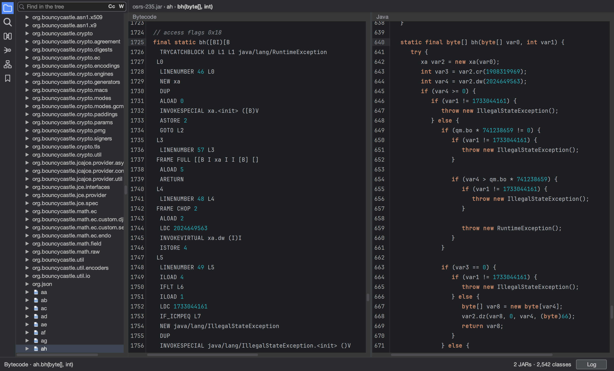
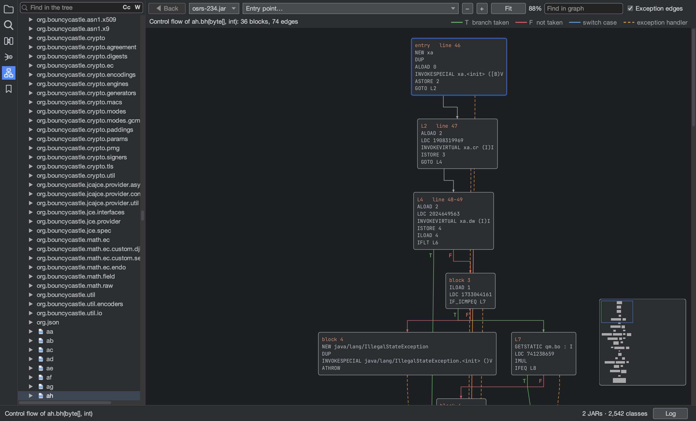
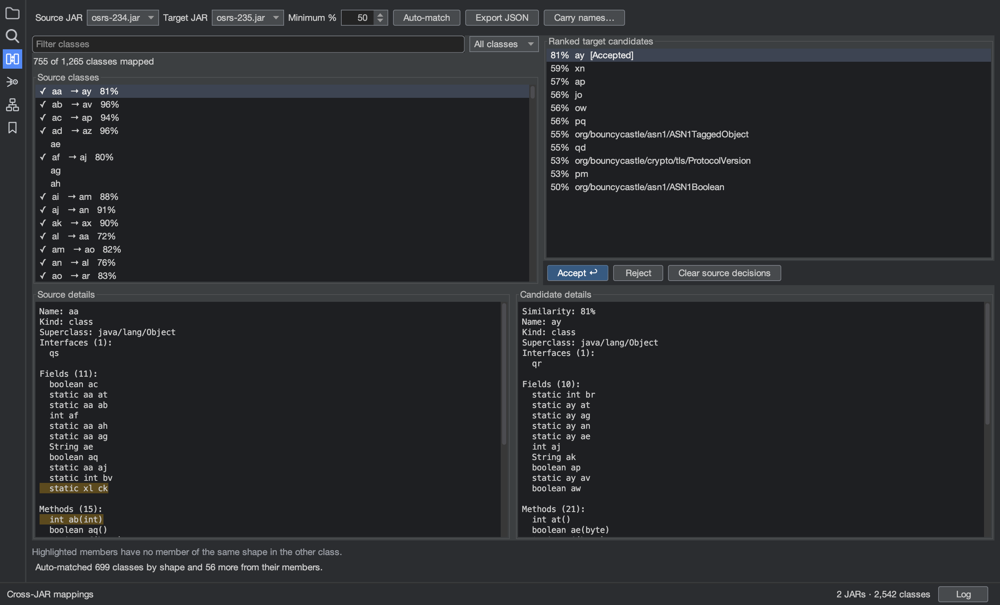

# Rikr

A workbench for reverse engineering Java bytecode, built for obfuscated JARs such as game clients.



- **Read** ASM bytecode and decompiled Java side by side, kept in step as you click either one.
- **Follow** references, callers and callees, entry points, call graphs and control flow graphs.
- **Rename** classes, fields and methods safely, with a preview and undo, then export the JAR.
- **Map** classes and members between versions of a program, and carry your names to the next one.
- **Exchange** tiny v2, Enigma and ProGuard mapping files.
- **Automate** all of it from an AI agent through the built-in MCP server.

| Control flow | Class matching between versions |
|---|---|
|  |  |

## Install

Download a package with its own Java runtime from the
[releases page](https://github.com/DevOldSchool/rikr/releases): a `.dmg` for macOS (Apple silicon), a `.zip` for
Windows, and a `.tar.gz`, `.deb` or `.rpm` for Linux.

## Build from source

Rikr needs Java 21 and Maven.

```bash
mvn -q -DskipTests package
java -cp "target/classes:target/lib/*" org.de.rikr.Rikr
```

`mvn verify` runs everything CI checks. Pushing a tag such as `v1.2.0` publishes a release.

## Use from an AI agent

`bin/rikr-mcp` runs Rikr as a [Model Context Protocol](https://modelcontextprotocol.io) server over stdio, so agents
such as Claude Code can load JARs, read and decompile code, follow references, rename, match classes and import or
export mappings without the GUI. This repository's `.mcp.json` registers it for Claude Code.

## Documentation

- [Getting started](docs/guides/getting-started.md): open JARs, navigate, search, shortcuts.
- [Renaming and mapping files](docs/guides/renaming.md)
- [References and call hierarchy](docs/guides/references.md)
- [Entry points, flow and simulation](docs/guides/flow.md)
- [Mapping between versions](docs/guides/mapping-versions.md)
- [Projects and bookmarks](docs/guides/projects.md)
- [AGENTS.md](AGENTS.md): how the code is organised, for contributors and coding agents.

## License

[GPL-3.0](LICENSE)
