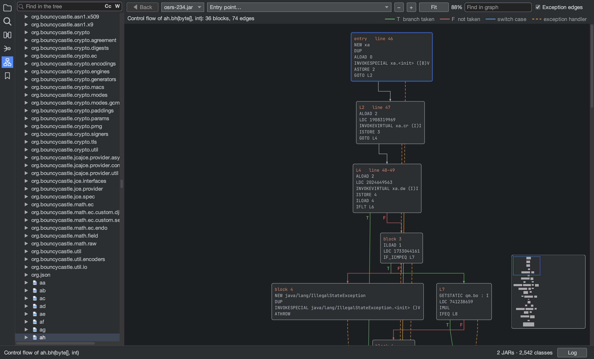

# Entry points, flow and simulation

## Entry points and call graphs

Open **View > Entry Points and Flow** (`Shift+Cmd+C`), or right-click a JAR and choose **Show Entry Points**, then
pick where the code starts: the manifest's Main-Class, `main` methods, applets (including obfuscated ones), thread
`run()` methods or event listeners. The call graph that opens shows what the method calls; click a method's badge to
show its calls, and double-click it for its control flow graph.

A method's right-click menu in the project tree also has **Show Call Graph** and **Show Control Flow**.

## Control flow graphs

A control flow graph shows a method's basic blocks, with branches taken in green, branches not taken in red, switch
cases in blue and exception handlers dashed. Right-click a block to follow the methods it calls, and double-click it
to see it in the bytecode view. **Back** retraces the path.

**Fit** shows the whole graph when its text stays readable; a larger graph is fitted to its width and opens at the
top, with an overview in the corner to click or drag around. Type in **Find in graph** and press `Enter` to go to the
next block or method containing that text.

## Simulate a method

Right-click a method in the project tree and choose **Simulate Method** to step through it without running it.
**Step forwards** and **Step backwards** move one instruction at a time while the panel shows the operand stack and
local variables. At a branch whose outcome can't be known, choose **Jump** or **Don't jump**. Values that depend on
something outside the method, such as a parameter or a call's result, show as unknown rather than guessed; calls are
not followed.
