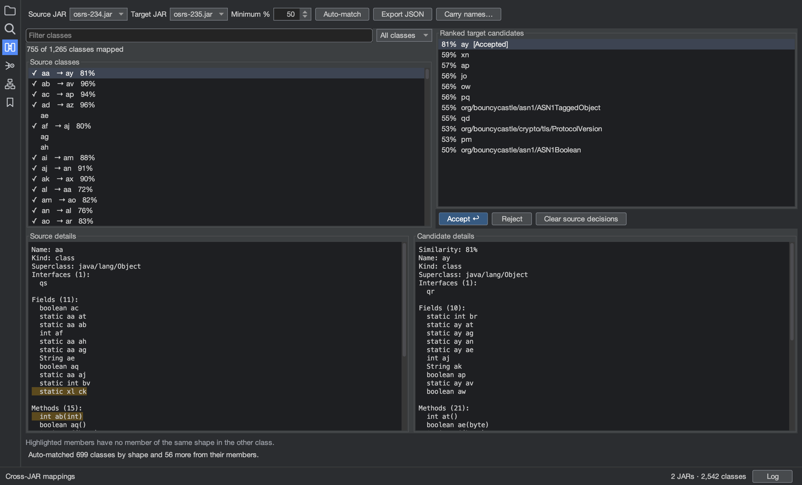

# Mapping between versions

Obfuscated programs get new names in every release. Rikr matches the classes, fields and methods of one version to
the next, so the names you gave the old version can be carried to the new one.

## Match classes

Load both JARs, then open **View > Cross-JAR Mappings** (`Shift+Cmd+M`) and choose the source and target JARs. For
each source class, the ranked candidates on the right are compared by shape: fields, methods, interfaces and
superclass. Members with no member of the same shape in the other class are highlighted.

- Press `Enter` to accept the selected candidate and move to the next unmapped class, or `Delete` to reject it.
- **Auto-match** accepts every class whose best candidate is unique and at least the **Minimum %**. It then matches
  more classes from their matched fields and methods, which also works when a deobfuscator changed a class's shape.
- Filter the source list by name, or show only mapped or unmapped classes.

Mappings are one-to-one within a JAR pair. Rejected candidates are remembered for the session. **Export JSON** saves
the accepted class mappings.

## Carry names

With some classes accepted, **Carry names…** matches the fields and methods inside them by what their code does and
how they are used, then gives the target JAR the names from the source JAR. It shows how many classes, fields and
methods it will rename before anything changes, and the whole rename is undone in one step.

- Names already given in the target are kept.
- Renames that can't be made are left out, with the reason.
- **Also carry the names the JAR was loaded with** is for a source JAR that was named before it was loaded, such as a
  deobfuscated build. Names a deobfuscator made up, such as `class12` or `field34`, are not carried.

Matches are good but not certain, so check the ones that matter.
